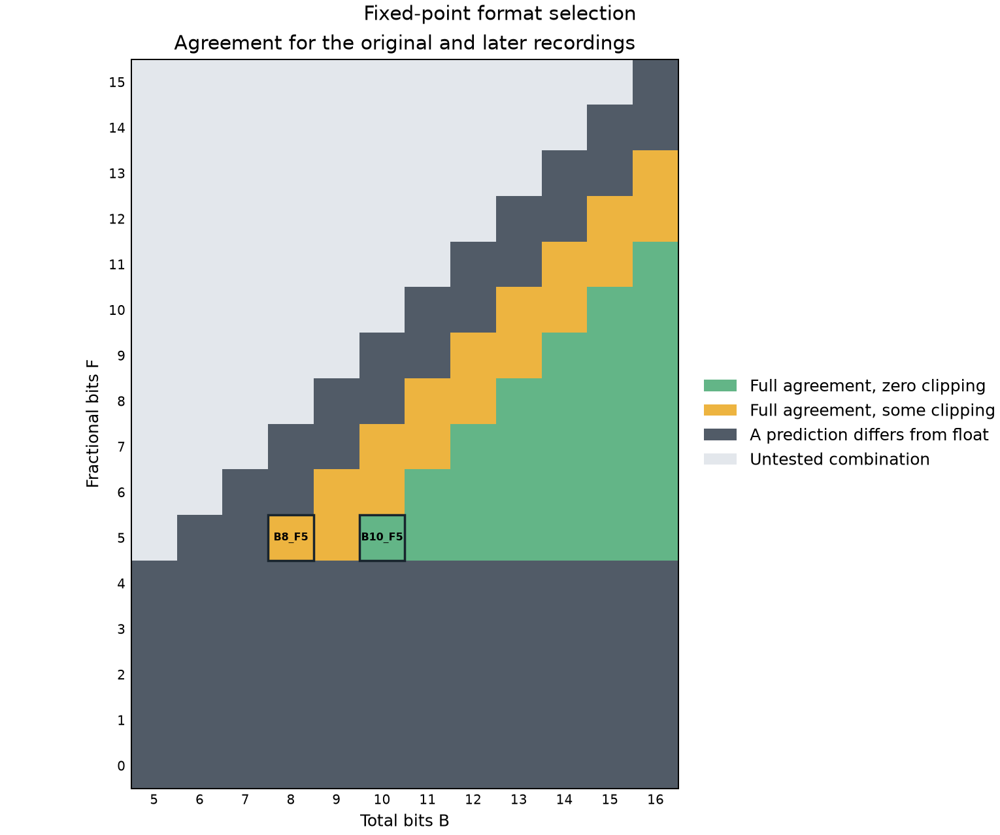

# FPGA extension: fixed-point guitar string/fret classification

This project extends the existing classical-guitar string/fret localisation classifier with an FPGA implementation of fixed-point inference. It investigates how **number representation** and **multiply–accumulate (MAC) architecture** affect prediction agreement, logic utilisation, clock frequency and inference latency.

The classifier uses five note-specific, three-class models (E4, D3, E3, F4 and G3). Audio feature extraction and standardisation run in Python; the FPGA receives eight quantised features, selects the relevant model coefficients and computes the three class scores. The target board is the **Terasic DE10-Lite (Intel MAX 10)**.

The FPGA extension contains [Python quantisation and sweep scripts](python/), [exported models](models/), [SystemVerilog and Quartus projects](rtl/), [simulation tests](tb/), and [results](results/). The [software guide](../docs/software_maintenance.md) covers setup and the original [Python classifier](../src/).

Prediction agreement measures how often fixed-point inference preserves the floating-point classifier's decisions. Classification accuracy requires verified string/fret labels. The original 150 recordings were used during model development, and the additional 30 recordings were made in a separate session.

## Motivation and numerical representation

This part of the project aims to explore and compare the performance and area of different number formats for fixed-point classification accelerators on an FPGA.

Fixed-point arithmetic is attractive for FPGA-based ML inference because it allows fractional quantities to be represented without the added complexity introduced for floating-point arithmetic. This means that logic circuits can be simpler, reducing the area/number of logic elements used and shortening the critical path, potentially leading to lower inference latency.

However, there are trade-offs to consider with fixed-point representations. The precision and range of the chosen binary format need to be sufficient to ensure that the classifier does not lose so much information that classification becomes incorrect. Increasing the precision and range by using more bits can increase resource usage and inference latency. For a fixed total bit width, increasing fractional precision reduces the representable range.

### Datatype and notation

A fixed-point number has an integer and fractional part. The size of the fractional part determines the **resolution** (e.g. two fractional bits provide increments of 0.25, while four provide increments of 0.0625). The remaining bits determine the representable integer range, including the sign.

Formats use the notation **`B{total}_F{fractional}`**, where `B` is the total bit width **including the sign bit** and `F` is the number of fractional bits. Thus `B − F` bits remain for sign and integer positions. For example, signed `B5_F2` represents values from **−4 to +3.75**, in steps of **0.25**.

For a real value `x`, the integer encoding follows the project’s rounding-and-clipping convention:

```text
q = clip(round(x × 2^F), −2^(B−1), 2^(B−1) − 1)
x_approx = q / 2^F
```

Rounding is to nearest integer (ties to even); representational overflow is clipped/saturated rather than allowed to wrap. Multiplying two `F`-fractional-bit operands gives a product with `2F` fractional bits, so the accumulator and bias share that fractional scaling and use a wider signed integer representation. In the parameterised RTL, `ACC_BITS = 2*BITS + 4`.

## 1. Initial format exploration

The first numerical experiments compared a small number of candidate formats with the floating-point reference. For example, `B4_F2` has a range of −2 to +1.75 and matched all 150 predictions despite clipping 54 features.

The exploration was therefore extended to track **feature clipping, weight clipping and prediction disagreement**, separately for each note. The original-recording sweep gave the following overall results:

| Format | Agreement with floating point (150 recordings) | Clipped features | Clipped weights |
| --- | ---: | ---: | ---: |
| B1_F0 | 91/150 | 387 | 23 |
| B2_F1 | 144/150 | 363 | 10 |
| B4_F1 | 149/150 | 1 | 0 |
| B4_F2 | 150/150 | 54 | 0 |
| **B5_F2** | **150/150** | **0** | **0** |
| B6_F3 | 150/150 | 0 | 0 |
| B8_F4 | 150/150 | 0 | 0 |
| B12_F8 | 150/150 | 0 | 0 |
| B16_F10 | 150/150 | 0 | 0 |

`B5_F2` was the smallest **initially selected** format with full agreement and no observed feature or weight clipping. `B6_F3` and `B8_F4` were retained for a controlled hardware-width comparison.

The per-note breakdown is available for [agreement](results/numerical_exploration/prediction_agreement.csv), [feature clipping](results/numerical_exploration/clipped_features.csv), and [weight clipping](results/numerical_exploration/clipped_weights.csv).

## 2. Fixed-point RTL architecture

Each note-specific logistic-regression model has **three output classes**, each with eight weights and one bias. The FPGA receives eight already-standardised, quantised features. Three iterative MAC units compute class scores in parallel:

```text
Python: audio → feature extraction → standardisation → quantisation
                                                       │
                                              features[0:7], note
                                                       │
                                      ┌────────────────┴───────────────┐
                                      │  model coefficient lookup      │
                                      │  (24 weights + 3 biases/note)  │
                                      └────────────────┬───────────────┘
                                                       │
                         ┌─────────────────────────────┼─────────────────────────────┐
                         ▼                             ▼                             ▼
                   MAC: class 0                  MAC: class 1                  MAC: class 2
                         │                             │                             │
                         └─────────────────────────────┼─────────────────────────────┘
                                                       ▼
                                           signed argmax / class index
```

The original MAC performs operand selection, signed multiplication, saturating accumulation and score registration in one cycle. Eight feature–weight products are accumulated serially **within each MAC**, while the three MACs operate **in parallel**. The class comparator selects the largest signed score, with deterministic tie-breaking. The original classifier core requires **9 clock cycles** from start acceptance to registered output.

### Pipelined MAC

Analysis of the original design identified a long register-to-register path:

```text
counter → coefficient/feature mux → DSP multiplication
        → accumulator addition → saturation → score register
```

A product register was inserted between multiplication and accumulation. The updated pipeline overlaps multiplication of the next feature with accumulation of the previous product, followed by a drain cycle for the final product:

```text
Stage 1: counter → operand selection → DSP multiplication → product_reg
Stage 2: product_reg → addition/saturation → score register
```

This changes the core latency from **9 to 10 cycles**. In the pipelined coefficient-fed benchmarks, the critical path terminates at `product_reg`, with operand selection, routing and DSP multiplication dominating.

## 3. Quartus implementation and timing comparison

The working notes record repeated builds using **Quartus Prime Lite 25.1**, **20 ns clock constraint**, **post-fit Fmax**, **slow 1.2 V / 85 °C timing corner** and the `10M50DAF484C7G` MAX 10 device. Coefficient-fed timing wrappers used virtual data pins. These repeated results supersede earlier historical synthesis snapshots made with different settings or device selection.

| Format | Original LEs | Original Fmax (MHz) | Pipelined LEs | Pipelined Fmax (MHz) |
| --- | ---: | ---: | ---: | ---: |
| B5_F2 | 521 | 75.80 | 533 | 109.83 |
| B6_F3 | 613 | 78.19 | 621 | 112.96 |
| B8_F4 | 797 | 71.89 | 808 | 110.60 |

| Format | Original core latency at Fmax (ns) | Pipelined core latency at Fmax (ns) |
| --- | ---: | ---: |
| B5_F2 | 118.73 | 91.05 |
| B6_F3 | 115.10 | 88.53 |
| B8_F4 | 125.19 | 90.42 |

Pipelining improves the achievable Fmax while adding relatively few LEs. The repeated timing reports found a shorter combined path through operand selection and the DSP input for pipelined B6_F3 than for B5_F2. Placement and routing contribute to the difference.

At the DE10-Lite’s **50 MHz** clock, the original core takes **180 ns** (9 cycles) and the pipelined core takes **200 ns** (10 cycles). The coefficient-fed timing wrappers add two cycles. The table estimates core latency by dividing the core cycle count by each wrapper's post-fit Fmax.

## 4. Model storage, verification and DE10-Lite deployment

Five trained models are stored as quantised parameters for note-specific inference (E4, D3, E3, F4 and G3). Each model contains 24 weights and three biases. Python exports hexadecimal coefficient memories; the RTL reads those parameters with `$readmemh` and supplies them to the three MACs. Preprocessing statistics remain on the host, rather than implementing audio DSP or standardisation on the FPGA.

The [model bank](rtl/load_model.sv) uses one-dimensional weight and bias memories with per-note base offsets for Quartus compatibility.

The cocotb/Verilator tests compare RTL outputs against a Python fixed-point reference. The [DE10-Lite regression wrapper](rtl/de10lite_top_regression.sv) runs stored quantised test vectors and displays how many predicted classes match the Python fixed-point reference. The B6_F3 build displayed **150** on the physical board using the original vectors.

The general B6_F3 full classifier used **442 LEs** and reached **101.80 MHz**. The fixed-input board demo used **263 LEs** and reached **159.64 MHz** because fixing inputs lets Quartus simplify the datapath. The separate B6_F3 board regression build includes the vector ROM, runner and display logic. It used **1,402 LEs** and reached **105.16 MHz**.

## 5. Evaluation on independent recordings

Testing on an additional set of **30 independent recordings** revealed limitations of selecting precision solely from the original 150 examples. The three initially synthesised formats each disagreed with the floating-point Python model on **one of the 30** recordings, but on **different** examples:

| Format | Agreement with floating point (independent set) | Changed prediction |
| --- | ---: | --- |
| B5_F2 | 29/30 | `test_1.wav` |
| B6_F3 | 29/30 | `test_24.wav` |
| B8_F4 | 29/30 | `test_8.wav` |
| B8_F5 | 30/30 | None |
| B10_F5 | 30/30 | None |
| B12_F8 | 30/30 | None |
| B16_F10 | 30/30 | None |

Verilator also matched the B6_F3 Python fixed-point reference on all 30 independent examples. This separates the numerical representation effect from an apparent RTL mismatch.

The recording groups identify the played notes. The mapping from all 30 files to their true string/fret positions remains unverified, so the table reports prediction agreement.

## 6. Expanded two-dimensional precision sweep

The independent-set disagreements motivated a grid over total bits `B` and fractional bits `F`. The [Python sweep](results/numerical_exploration/bit_fraction_sweep.csv) evaluated **126 signed formats** with `5 ≤ B ≤ 16` and `0 ≤ F < B`, recording floating-point prediction agreement and clipping of features, weights and biases.

Increasing `F` improves resolution and reduces range at a fixed `B`. Some configurations preserve every observed prediction even when a feature clips.

The sweep identified:

| Format | Agreement across both sets | Observed clipping | Interpretation |
| --- | ---: | --- | --- |
| **B8_F5** | **180/180** | 1 later-session feature | Smallest tested total width with full agreement |
| **B10_F5** | **180/180** | **0** | Smallest tested total width with full agreement and zero observed clipping |



The [two-panel agreement heatmap](results/plots/bit_fraction_agreement.png) uses the same scale for the 150 original and 30 independent recordings. The [clipping heatmaps](results/plots/bit_fraction_clipping.png) show counts and maximum excess for features, weights and biases. Grey cells mark untested combinations.

## 7. Final format selection and limitations

**B10_F5** is the smallest tested width that preserves all 180 predictions without observed clipping. It uses signed 10-bit features and weights with five fractional bits, and signed 24-bit biases and accumulators with ten fractional bits. The hardware comparison uses the ROM-fed `full_classifier` for both formats with the device, clock constraint and timing corner in section 3.

| Metric | B8_F5 | B10_F5 |
| --- | ---: | ---: |
| Agreement with floating-point model | 180/180 | 180/180 |
| Observed clipped features | 1 | 0 |
| Logic elements | 535 | 590 |
| Registers | 284 | 314 |
| DSP multiplier blocks | 2 | 3 |
| Post-fit Fmax (MHz) | 91.26 | 73.47 |
| Core inference latency (cycles) | 10 | 10 |
| Estimated core inference latency at Fmax (ns) | 109.6 | 136.1 |

For this build, B10_F5 removes the one observed feature clip at a cost of 55 LEs and one DSP multiplier block. Its post-fit Fmax is 17.79 MHz lower, while both formats have the same 200 ns core latency at the board's 50 MHz clock.

Cocotb/Verilator matched the B10_F5 Python reference on **450/450 MAC scores**, **150/150 classifier predictions** with supplied coefficients and **150/150 full-classifier predictions** with ROM-loaded coefficients. The board regression matched **180/180** in Verilator for both B8_F5 and B10_F5. Physical results for these two formats are pending.

| Other B10_F5 builds | LEs | Registers | DSP multiplier blocks | Fmax (MHz) | Start to valid (cycles) | Estimated latency at Fmax (ns) |
| --- | ---: | ---: | ---: | ---: | ---: | ---: |
| Coefficient-fed timing wrapper | 986 | 798 | 3 | 99.46 | 12 | 120.7 |
| DE10-Lite regression wrapper | 1,990 | 298 | 3 | 98.57 | 10 | 101.5 |

The board regression had **+9.855 ns setup slack** at 50 MHz. Its latency is measured from classifier start to valid, excluding button synchronisation and the interval between test launches. The SDC models the 50 MHz clock and omits clock uncertainty and external I/O delays. The selection is based on 30 independent recordings and the 150 recordings used for model development.

## Reproducing the experiments

From the repository root, activate the project environment and set `recordings_dir` to the directory containing `test_1.wav` through `test_30.wav`. Regenerating the plots requires Matplotlib.

```bash
source .venv/bin/activate
recordings_dir=/path/to/independent-recordings
python -m fpga.python.sweep_later_session "$recordings_dir"
python -m fpga.python.sweep_bit_fraction_grid "$recordings_dir"
python -m fpga.python.plot_bit_fraction_sweep
python -c 'from fpga.python.convert_models_to_rom import generate_rom; generate_rom(10, 5)'
python -m fpga.python.generate_regression_rom --format b10_f5 --recordings-dir "$recordings_dir"
bash fpga/tb/run_full_classifier.sh b10_f5
make -C fpga/tb/mac BITS=10
make -C fpga/tb/mac BITS=10 MODULE=mac_functional_validation \
    TOPLEVEL=pipelined_parametrised_multiply_accumulate \
    VERILOG_SOURCES="$PWD/fpga/rtl/pipelined_parametrised_multiply_accumulate.sv" \
    SIM_BUILD=sim_build/mac_b10
```

The B10_F5 regression ROM contains 180 words, each stored as 22 hex digits. Each word has eight 10-bit features in bits `[79:0]` (feature 0 first), the expected class in `[81:80]`, the note in `[84:82]` and zero padding above it. The generated ROMs are available in [`rtl/rom/`](rtl/rom/), so the hardware projects can be built without the WAV files.

From `fpga/rtl`, run the following with Quartus Prime Lite 25.1 on your PATH. In the Quartus GUI, open the corresponding `.qpf` and run **Processing → Start Compilation**.

```bash
quartus_sh --flow compile b10_f5_timing -c b10_f5_timing
quartus_sh --flow compile b10_f5_full_classifier -c b10_f5_full_classifier
quartus_sh --flow compile b10_f5_board_regression -c b10_f5_board_regression
```

Quartus writes the fitter and timing reports to `fpga/rtl/output_files/`. For the board regression, add `b10_f5_board_regression.sof` from that directory to Quartus Programmer, select **USB-Blaster** in **JTAG** mode, check **Program/Configure**, and click **Start**. After programming, press **KEY0** to reset and **KEY1** to run. The expected display is **180**.

To reproduce the B8_F5 comparison, copy the full-classifier project, its sources and SDC to a separate directory. Set `BITS` to 8 in the copied QSF and generate the B8_F5 coefficients with `generate_rom(8, 5)`. Place the resulting files in the copied project's `rom/` directory and set `WEIGHTS_FILE` and `BIASES_FILE` in the copied `load_model.sv` to the literal paths `"rom/b8_f5_weights.mem"` and `"rom/b8_f5_biases.mem"`. Quartus interpreted the shorter filename branch of the current default expression as a binary constant during elaboration. The comparison run used explicit filenames in the temporary project.
